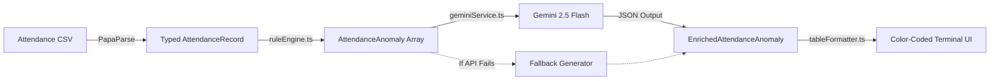

# Attendance Checker Tool

An intelligent workplace compliance and attendance auditing utility built with **TypeScript**, **Node.js**, **PapaParse**, and **Google Gemini** (`gemini-2.5-flash`).

The tool parses attendance CSV files containing scheduled hours, punch times, and leave requests, identifies compliance discrepancies across five core operational rules, enriches each anomaly with AI-generated single-sentence explanations and HR recommendations, and renders a color-coded terminal review table grouped by severity.

---

## Architecture & Workflow



1. **CSV Ingestion & Coercion ([`src/utils/parseAttendance.ts`](src/utils/parseAttendance.ts)):** Reads raw CSV files using `papaparse`, coerces numbers, maps nullable timestamps, parses approval booleans, and validates row integrity.
2. **Rule Engine ([`src/engine/ruleEngine.ts`](src/engine/ruleEngine.ts)):** Evaluates records using time-difference math across shifts (including overnight shifts) against 5 compliance rules.
3. **AI Explanation Service ([`src/services/geminiService.ts`](src/services/geminiService.ts)):** Sends detected anomalies to `gemini-2.5-flash` using `responseMimeType: 'application/json'` to produce professional, single-sentence explanations and actionable HR recommendations, backed by an automated fallback.
4. **Terminal Formatter ([`src/utils/tableFormatter.ts`](src/utils/tableFormatter.ts)):** Renders word-wrapped, ANSI color-coded tables grouped by severity (`HIGH`, `MEDIUM`) using `cli-table3`.

---

## Detected Anomaly Patterns

| Anomaly Code | Severity | Trigger Condition |
| :--- | :--- | :--- |
| `UNEXPLAINED_ABSENCE` | `HIGH` (Critical) | `scheduled_hours > 0`, no clock-in, no clock-out, and `leave_type === 'None'`. |
| `MISSING_CLOCK_OUT` | `MEDIUM` (Warning) | Clock-in exists, clock-out is missing, and `leave_type === 'None'`. |
| `EXCESSIVE_OVERTIME` | `HIGH` (Critical) | Worked net duration $> 12.0$ hours in a single shift. |
| `WORKING_ON_LEAVE` | `MEDIUM` (Warning) | Clock-in and clock-out exist while `leave_type` is Sick or Annual leave. |
| `SEVERE_TARDINESS` | `MEDIUM` (Warning) | Clock-in is 10:30 AM or later for a standard morning shift without leave. |

---

## CSV Schema Structure

The sample dataset ([`sample_attendance.csv`](sample_attendance.csv)) supports 70% normal shifts and 30% anomaly edge cases:

| Field Name | Type | Format | Description |
| :--- | :--- | :--- | :--- |
| `employee_id` | `string` | `EMP001` | Unique employee identifier |
| `employee_name` | `string` | `Alice Chen` | Full employee name |
| `department` | `string` | `Engineering` | Department / team name |
| `date` | `string` | `YYYY-MM-DD` | Date of attendance |
| `scheduled_hours` | `number` | `8.0`, `0.0` | Expected shift duration (0.0 on days off) |
| `clock_in` | `string \| null` | `HH:mm` | Shift start punch (or blank) |
| `clock_out` | `string \| null` | `HH:mm` | Shift departure punch (or blank) |
| `break_minutes` | `number` | `30`, `60` | Unpaid break duration deducted from net hours |
| `actual_hours` | `number` | `8.0`, `16.0` | Net recorded hours worked |
| `leave_type` | `string` | `None`, `Annual Leave` | Applied leave category |
| `leave_hours` | `number` | `0.0`, `8.0` | Approved leave hours |
| `is_approved` | `boolean` | `TRUE` / `FALSE` | Management pre-approval flag |

---

## Project Structure

```text
attendance-checker/
├── data/
│   └── attendance_sample.csv       # Source sample dataset (30 rows)
├── sample_attendance.csv           # Symlink / root copy for quick runs
├── src/
│   ├── types/
│   │   └── attendance.ts           # TypeScript interfaces (Record, Anomaly, Flags)
│   ├── utils/
│   │   ├── parseAttendance.ts      # PapaParse ingestion & validation script
│   │   └── tableFormatter.ts       # cli-table3 color-coded terminal view
│   ├── engine/
│   │   └── ruleEngine.ts           # Anomaly rule checks & time diff helpers
│   ├── services/
│   │   └── geminiService.ts        # Gemini 2.5 Flash AI enrichment & fallback
│   └── demo.ts                     # Full pipeline runner script
├── .env.example                    # Environment variable template
├── package.json                    # Project configuration & scripts
├── tsconfig.json                   # TypeScript compiler configuration
├── PROMPT_ENGINEERING.md           # LLM prompt evolution and design log
└── README.md                       # Documentation & setup guide
```

---

## Prerequisites

* **Node.js:** v20.0.0 or later (Node 24 recommended, supports native `.env` loading).
* **npm:** v10.0.0 or later.
* **Gemini API Key:** Optional for AI enrichment. *(If omitted or invalid, the tool automatically uses rule-based fallback explanations without failing).*

---

## Setup & Installation

1. **Clone or Navigate to the Repository:**
   ```bash
   cd /Users/macbook/Documents/attendance-checker
   ```

2. **Install Dependencies:**
   ```bash
   npm install
   ```

3. **Configure Environment Variables:**
   Copy the example environment file and add your Gemini API key:
   ```bash
   cp .env.example .env
   ```
   Open `.env` and set your key:
   ```env
   GEMINI_API_KEY="your_actual_gemini_api_key_here"
   ```
   *(Note: If you leave the placeholder, the system activates the fallback generator seamlessly).*

---

## Available Commands

### 1. Build the TypeScript Project
Compiles TypeScript into production JavaScript in `dist/`:
```bash
npm run build
```

### 2. Start the Express Web Server (Production)
Runs the compiled server listening on `PORT` (defaults to 3000):
```bash
npm start
```
* Visit `http://localhost:3000` to view the mobile-responsive compliance dashboard.
* Visit `http://localhost:3000/health` for the health check endpoint.
* Visit `http://localhost:3000/api/anomalies` for JSON API output.

### 3. Local Development Server
Runs the Express server with live TypeScript execution via `tsx`:
```bash
npm run dev
```

### 4. CLI Table Walkthrough
Runs the terminal review view powered by `cli-table3`:
```bash
npm run cli
# or: npx ts-node src/index.ts
```

### 5. Parse CSV Only
Loads and inspects parsed `AttendanceRecord` objects from CSV:
```bash
npm run parse
```

### 6. TypeScript Typecheck
Validates all types without emitting JavaScript:
```bash
npm run typecheck
```

---

## Deploying to Render (Web Service)

To deploy this project as a live web service on [Render](https://render.com):

1. **Create New Web Service:** Connect your GitHub repository.
2. **Environment:** `Node`
3. **Build Command:**
   ```bash
   npm install && npm run build
   ```
4. **Start Command:**
   ```bash
   npm start
   ```
5. **Environment Variables:**
   - `NODE_ENV`: `production`
   - `GEMINI_API_KEY`: *(Optional)* Your Google Gemini API Key.
   - `PORT`: *(Render sets this automatically)*


---

## Terminal Output Example

```text
● HIGH SEVERITY DISCREPANCIES (3)
Immediate review required — significant compliance, rest-period, or absence violations.
┌──────────────────────┬────────────┬────────────────────────┬────────────────────────────────────────────────────┐
│ Employee             │ Date       │ Rule Violation         │ AI Explanation                                     │
├──────────────────────┼────────────┼────────────────────────┼────────────────────────────────────────────────────┤
│ Clara Diaz           │ 2026-10-06 │ EXCESSIVE OVERTIME     │ Clara Diaz (EMP003) recorded a shift duration      │
│ (EMP003)             │            │                        │ exceeding the safe daily limit of 12.0 hours on    │
│                      │            │                        │ 2026-10-06.                                        │
├──────────────────────┼────────────┼────────────────────────┼────────────────────────────────────────────────────┤
│ David Kim            │ 2026-10-06 │ UNEXPLAINED ABSENCE    │ David Kim (EMP004) recorded no clock-in or         │
│ (EMP004)             │            │                        │ clock-out punches on a scheduled 8h shift with no  │
│                      │            │                        │ approved leave filed.                              │
├──────────────────────┼────────────┼────────────────────────┼────────────────────────────────────────────────────┤
│ David Kim            │ 2026-10-08 │ EXCESSIVE OVERTIME     │ David Kim (EMP004) recorded a shift duration       │
│ (EMP004)             │            │                        │ exceeding the safe daily limit of 12.0 hours on    │
│                      │            │                        │ 2026-10-08.                                        │
└──────────────────────┴────────────┴────────────────────────┴────────────────────────────────────────────────────┘

▲ MEDIUM SEVERITY DISCREPANCIES (3)
Manager verification required — missing punches, leave conflicts, or severe tardiness.
┌──────────────────────┬────────────┬────────────────────────┬────────────────────────────────────────────────────┐
│ Employee             │ Date       │ Rule Violation         │ AI Explanation                                     │
├──────────────────────┼────────────┼────────────────────────┼────────────────────────────────────────────────────┤
│ Alice Chen           │ 2026-10-08 │ MISSING CLOCK OUT      │ Alice Chen (EMP001) clocked in at 09:00 on         │
│ (EMP001)             │            │                        │ 2026-10-08 but failed to log a departure           │
│                      │            │                        │ timestamp.                                         │
├──────────────────────┼────────────┼────────────────────────┼────────────────────────────────────────────────────┤
│ Bob Miller           │ 2026-10-06 │ WORKING ON LEAVE       │ Bob Miller (EMP002) recorded active work punches   │
│ (EMP002)             │            │                        │ (08:00 - 16:30) during approved Sick Leave.        │
├──────────────────────┼────────────┼────────────────────────┼────────────────────────────────────────────────────┤
│ Tom Bradley          │ 2026-10-15 │ SEVERE TARDINESS       │ Tom Bradley (EMP009) clocked in at 11:15 on        │
│ (EMP009)             │            │                        │ 2026-10-15, significantly past the morning start   │
│                      │            │                        │ window without approved half-day leave.            │
└──────────────────────┴────────────┴────────────────────────┴────────────────────────────────────────────────────┘

Total Flagged Records: 6 (3 High, 3 Medium)
```

---

## Documentation

* For deep details on prompt design, schema enforcement, latency optimization, and fallback matrices, see [PROMPT_ENGINEERING.md](PROMPT_ENGINEERING.md).

